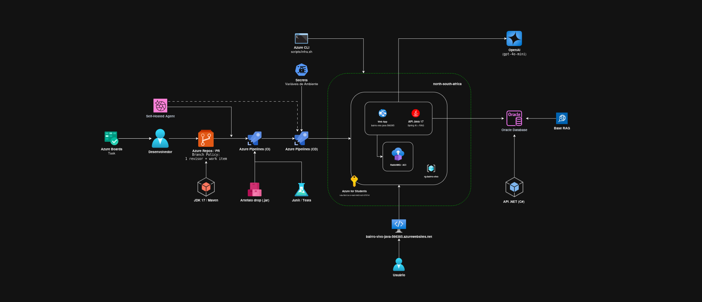

# Bairro Vivo — DevOps Tools & Cloud Computing (Global Solution)

Repositório da entrega de **DevOps Tools & Cloud Computing** da Global Solution. A solução implementa **pipelines de CI/CD no Azure DevOps** com deploy automático da API Java em um **Azure Web App**, consumindo um **banco Oracle em nuvem**, um **RabbitMQ em container (Azure Container Instances)** e um **modelo de linguagem da OpenAI** para a geração de orientações. Toda a infraestrutura é provisionada por **script Azure CLI** (`scripts/infra.sh`), sem uso manual do portal.

---

## Sumário

1. [Solução proposta](#1-solução-proposta)
2. [Conceito: orientação com IA (RAG)](#2-conceito-orientação-com-ia-rag)
3. [Benefícios para o negócio](#3-benefícios-para-o-negócio)
4. [Arquitetura e fluxo CI/CD](#4-arquitetura-e-fluxo-cicd)
5. [Banco de dados em nuvem](#5-banco-de-dados-em-nuvem)
6. [Infraestrutura via Azure CLI](#6-infraestrutura-via-azure-cli)
7. [Projeto no Azure DevOps](#7-projeto-no-azure-devops)
8. [Pipelines CI/CD](#8-pipelines-cicd)
9. [Segurança e gestão de segredos](#9-segurança-e-gestão-de-segredos)
10. [Como executar localmente](#10-como-executar-localmente)
11. [Roteiro demonstrado no vídeo](#11-roteiro-demonstrado-no-vídeo)
12. [Integrantes](#12-integrantes)
13. [Links da entrega](#links-da-entrega)

---

## 1. Solução proposta

O **Bairro Vivo** é uma plataforma de zeladoria colaborativa, no tema **CitizenTech**: o cidadão registra problemas do seu bairro (ocorrências) e acompanha o que acontece com eles. O problema que a solução ataca é prático: muitas vezes a pessoa registra a ocorrência, mas **não sabe a quem recorrer** nem qual é o canal oficial para aquele tipo de problema.

Esta entrega trata da **API Java** do ecossistema, responsável por:

- cadastro, autenticação e emissão de **JWT** (RS256), com chave pública exposta em JWKS para validação pela API .NET;
- preferências e **locais favoritos** do cidadão;
- publicação do evento `usuario.cadastrado` no **RabbitMQ**;
- **orientação cidadã com IA generativa (RAG)**: a partir de uma ocorrência, indica o canal oficial adequado, usando somente fontes aprovadas.

As ocorrências, votos, fotos, histórico e relatórios pertencem à **API .NET (C#)** do grupo, publicada à parte. **As duas APIs compartilham o mesmo banco Oracle**: a API .NET grava as ocorrências e a API Java as lê diretamente das tabelas compartilhadas, com permissão somente de leitura. Não há chamada HTTP entre as duas APIs no fluxo de orientação.

### Stack de tecnologias

| Camada | Tecnologia |
|---|---|
| Linguagem | Java 17 |
| Framework | Spring Boot 3.4.4 (Web, Data JPA, Security, OAuth2 Resource Server, AMQP, Actuator) |
| IA generativa | Spring AI com modelo OpenAI (`gpt-4o-mini`), com RAG sobre fontes oficiais |
| Documentação da API | springdoc-openapi (Swagger UI) |
| Mensageria | RabbitMQ (evento `usuario.cadastrado`) |
| Banco de dados em nuvem | Oracle, acesso via JDBC |
| Build e testes | Maven (JUnit; H2 nos testes) |
| Código-fonte | Azure Repos |
| Planejamento | Azure Boards |
| CI/CD | Azure Pipelines (YAML) |
| Agente de build/deploy | Self-hosted (pool `Default`) |
| Hospedagem da API | Azure Web App (App Service, Linux B1) |
| Hospedagem do RabbitMQ | Azure Container Instances (imagem `rabbitmq:3-management`) |
| Infraestrutura como código | Script Azure CLI (`scripts/infra.sh`) |
| Assinatura | Azure for Students |

## 2. Conceito: orientação com IA (RAG)

**RAG** (*Retrieval-Augmented Generation*) é a técnica em que o modelo **consulta uma base de documentos confiáveis antes de responder**, em vez de responder apenas com o que aprendeu no treinamento. Isso reduz alucinações, permite atualizar o conhecimento sem retreinar o modelo e deixa a resposta rastreável até uma fonte. Para um cidadão que vai ligar para um órgão público, um telefone inventado seria um problema real, e é isso que o RAG evita.

Na arquitetura, a **Base RAG** é um conjunto de fontes oficiais aprovadas armazenado no próprio Oracle (view `VW_TRECHOS_RAG_APROVADOS` e canais com `FL_VERIFICADO = 'S'`). A API Java a consulta na recuperação e o modelo da OpenAI (`gpt-4o-mini`) é usado apenas na etapa de geração.

Fluxo de uma orientação (`POST /api/v1/ia/orientacoes`):

1. O cliente envia somente o `ocorrenciaId`.
2. A API lê a ocorrência, a categoria e o município no Oracle (`TB_OCORRENCIA`, `TB_CATEGORIA`, `TB_MUNICIPIO`), sem incluir dados pessoais do autor. Ocorrências marcadas como excluídas não são elegíveis.
3. **Recuperação:** busca até 5 trechos de fontes oficiais aprovadas e os canais verificados na Base RAG.
4. **Portão de elegibilidade:** o modelo só é chamado se município e categoria tiverem fontes aprovadas.
5. **Geração:** o Spring AI envia ao modelo a ocorrência e os trechos recuperados. A instrução trata a descrição como dado não confiável, bloqueia *prompt injection* e proíbe inventar contatos e horários.
6. **Validação da saída:** a resposta é rejeitada se contiver número de contato, horário ou URL que não esteja nas fontes aprovadas.
7. **Persistência:** a orientação e as fontes são gravadas no Oracle pela procedure `PKG_BASE_IA.PR_REGISTRAR_ORIENTACAO`. Somente orientações publicadas ficam visíveis ao público.

Limitações assumidas: escopo restrito ao município de São Paulo, dependência da qualidade das fontes aprovadas, limite de 5 solicitações por minuto por usuário (por instância da API) e, em caso de falha do modelo, retorno de erro `503` padronizado, sem resposta fictícia.

## 3. Benefícios para o negócio

- O cidadão recebe o **canal oficial correto** para o seu problema, o que aumenta a chance de a ocorrência ser resolvida.
- A resposta é baseada em **fontes aprovadas e validada** antes de ser entregue, reduzindo o risco de informação errada em serviços públicos.
- O cadastro publica eventos no RabbitMQ, deixando a plataforma pronta para integrações assíncronas (notificações, auditoria).
- A integração entre as APIs Java e .NET por meio do **banco compartilhado** evita acoplamento HTTP e permite que cada API seja implantada de forma independente.
- A esteira de CI/CD elimina o deploy manual: todo código aprovado é compilado, testado e publicado de forma padronizada e repetível.
- A infraestrutura é reproduzível por script, e segredos e credenciais ficam fora do código-fonte.

## 4. Arquitetura e fluxo CI/CD



O diagrama divide a solução em quatro blocos: **entrega** (Boards, Repos e Pipelines), **provisionamento** (Azure CLI), **execução** (Web App e RabbitMQ no Resource Group) e **serviços de dados e IA** (Oracle, Base RAG, API .NET e OpenAI).

### Fluxo numerado

| # | Etapa | O que acontece |
|---|---|---|
| 0 | **Provisionamento (Azure CLI)** | O script `scripts/infra.sh` cria o Resource Group, o App Service Plan, o Web App e o container do RabbitMQ, e grava as variáveis de ambiente no Web App. |
| 1 | **Azure Boards** | Cada mudança começa numa Tarefa. A branch, os commits (`#ID`) e o Pull Request são vinculados a ela. |
| 2 | **Azure Repos / PR** | O desenvolvedor cria a branch, faz o commit e abre o PR para a `master`. A *branch policy* exige 1 revisor e vínculo com work item. |
| 3 | **Azure Pipelines (CI)** | Após o merge na `master`, o agente self-hosted compila com JDK 17 e Maven, executa os testes (JUnit), publica os resultados e gera o artefato `drop` (`.jar`). |
| 4 | **Azure Pipelines (CD)** | Disparada após o CI gerar o artefato, usa as variáveis secretas (Secrets) e faz o deploy automático no Web App `bairro-vivo-java-566385`. |
| 5 | **Execução em produção** | O Web App executa a API Java 17 (Spring AI + RAG), conecta ao Oracle e ao RabbitMQ (ACI) e chama a OpenAI quando a IA está habilitada. |
| 6 | **Acesso do usuário** | O usuário acessa a API em `bairro-vivo-java-566385.azurewebsites.net` (Swagger em `/swagger-ui.html`). |

### Componentes e responsabilidades

| Componente | Papel na solução |
|---|---|
| Azure Boards | Planejamento e rastreabilidade das tarefas. |
| Azure Repos | Hospeda o código, controla branches e Pull Requests e aplica a branch policy. |
| Azure Pipelines (CI) | Compila, executa os testes e publica o artefato `drop`. |
| Azure Pipelines (CD) | Publica o artefato no Web App, a cada novo artefato gerado. |
| Agente self-hosted (pool `Default`) | Máquina que executa os jobs de CI e de CD. |
| JDK 17 / Maven | Toolchain de build e de testes usada pelo CI. |
| Secrets (variáveis de ambiente) | Armazenam credenciais e chaves fora do código, usadas pela pipeline e pelo Web App. |
| Azure CLI (`scripts/infra.sh`) | Cria e configura a infraestrutura de forma repetível. |
| Azure Web App (Linux B1) | Executa a API Java 17 em produção. |
| Azure Container Instances | Executa o RabbitMQ em container. |
| Resource Group `rg-bairro-vivo` | Agrupa todos os recursos da solução na assinatura Azure for Students. |
| Oracle Database | Persiste os dados do ecossistema, compartilhado entre as APIs Java e .NET. |
| Base RAG | Fontes oficiais aprovadas, armazenadas no Oracle e consultadas na recuperação. |
| API .NET (C#) | Gerencia ocorrências, votos, fotos e relatórios, gravando no Oracle compartilhado. |
| OpenAI (`gpt-4o-mini`) | Gera o texto das orientações a partir do contexto recuperado. |

### Personas

- **Desenvolvedor:** cria a Tarefa, a branch e o PR, o que aciona todo o fluxo.
- **Cidadão (usuário):** acessa a API publicada no Web App, gerencia seu perfil e locais favoritos e solicita orientações.

## 5. Banco de dados em nuvem

- Banco: **Oracle em nuvem**, acessado por JDBC e compartilhado entre as APIs Java e .NET.
- O esquema é fornecido pelo grupo e **não é criado nem alterado pela aplicação** (`ddl-auto=none`). O DDL está em `scripts/script-bd.sql`.
- A API Java mantém suas próprias tabelas (usuários, preferências, locais favoritos, orientações) e lê as tabelas de ocorrência, categoria e município com **permissão somente de leitura**.
- URL, usuário e senha **não ficam no código**: são variáveis de ambiente protegidas (`ORACLE_URL`, `ORACLE_USER`, `ORACLE_PASSWORD`).

## 6. Infraestrutura via Azure CLI

Os recursos são criados pelo script `scripts/infra.sh`, sem uso do portal:

| Recurso | Nome / configuração |
|---|---|
| Assinatura | Azure for Students |
| Resource Group | `rg-bairro-vivo` (região South Africa North, `southafricanorth`) |
| App Service Plan | `plan-bairro-vivo` (Linux, B1) |
| Web App | `bairro-vivo-java-566385` (runtime Java 17) |
| Container Instance (RabbitMQ) | `rabbitmq-bairro-vivo` (imagem `rabbitmq:3-management`) |

O script também grava as variáveis de ambiente (*App settings*) no Web App. As credenciais são lidas do ambiente, nunca escritas no arquivo.

## 7. Projeto no Azure DevOps

| Configuração | Valor |
|---|---|
| Organização / Projeto | `RM566385` / `Bairro Vivo` |
| Visibility | Private |
| Version control | Git |
| Acesso do professor | Convidado com nível **Basic** na organização e **Project Administrators** no projeto |

**Boards:** uma Tarefa inicial, com branch, commits e Pull Request vinculados.

**Branch policy na `master`:** mínimo de 1 revisor, vínculo obrigatório com work item e revisor incluído automaticamente. Não é possível commitar direto na branch principal.

## 8. Pipelines CI/CD

O arquivo `azure-pipeline.yml` (raiz do repositório) define duas etapas, `Build` e `Release`, ambas executadas pelo agente self-hosted do pool `Default`:

| Requisito | Como é atendido |
|---|---|
| Pipeline conectada ao repositório | Azure Repos, branch `master`. |
| CI disparado por alteração | Trigger na `master`; com a branch protegida, só o merge de PR dispara o build. |
| CD após novo artefato | A etapa `Release` depende do sucesso do `Build` e roda automaticamente. |
| Artefato publicado | O `.jar` é publicado como artefato `drop`. |
| Testes no CI | `mvn clean package` executa os testes e publica os resultados JUnit. |
| Deploy na nuvem | Task `AzureWebApp@1` no Web App Linux. |
| Variáveis sensíveis protegidas | Senhas, tokens e chaves em variáveis secretas da pipeline (nunca no código). |

### Variáveis de ambiente da aplicação

`ORACLE_URL`, `ORACLE_USER`, `ORACLE_PASSWORD`, `JWT_ISSUER`, `JWT_AUDIENCE`, `JWT_TTL`, `JWT_PRIVATE_KEY_PATH`, `JWT_PUBLIC_KEY_PATH`, `RABBITMQ_HOST`, `RABBITMQ_PORT`, `RABBITMQ_USER`, `RABBITMQ_PASSWORD`, `BAIRROVIVO_AI_ENABLED`, `OPENAI_API_KEY`, `OPENAI_MODEL`.

Somente os **nomes** ficam documentados; os valores existem apenas nas variáveis da pipeline e nos *App settings* do Web App.

## 9. Segurança e gestão de segredos

- **Segredos fora do código:** credenciais do Oracle, do RabbitMQ, da OpenAI e as chaves RSA do JWT ficam em variáveis secretas da pipeline e nos *App settings* do Web App. Chaves e senhas nunca são versionadas.
- **Fluxo protegido:** a *branch policy* impede commits diretos na `master`, e todo código passa por revisão e vínculo com uma Tarefa antes do build.
- **Autenticação:** JWT assinado com RS256. A chave pública é publicada em `/.well-known/jwks.json` para validação pela API .NET. O cadastro público cria sempre o papel `CIDADAO`.
- **Menor privilégio no banco:** a credencial Oracle da API Java tem leitura somente nas tabelas de ocorrência, categoria e município, e a escrita nessas tabelas é exclusiva da API .NET.
- **IA com salvaguardas:** a descrição da ocorrência é tratada como dado não confiável, e a saída do modelo é validada contra as fontes aprovadas antes de ser persistida.
- **Diagnóstico restrito:** a rota `/api/v1/admin/health` é acessível apenas ao papel `ADMIN`.

## 10. Como executar localmente

```bash
docker compose up -d rabbitmq
./mvnw spring-boot:run
./mvnw test
```

Pré-requisitos: JDK 17, Docker, Oracle com o esquema do projeto e chaves RSA em `.secrets/` (fora do Git). Swagger UI em `http://localhost:8080/swagger-ui.html`.

## 11. Roteiro demonstrado no vídeo

1. Ferramentas: IDE, Azure DevOps, banco de dados e Portal do Azure.
2. Configuração das pipelines (jobs e tasks).
3. Recursos criados pelo script Azure CLI no Portal do Azure.
4. Nova Tarefa no Boards e nova branch.
5. Alteração visível no código da aplicação.
6. Commit e PR vinculados à Tarefa, e merge na `master`.
7. Início automático da pipeline e explicação de cada etapa do CI/CD.
8. Artefato criado e resultado dos testes.
9. Recursos atualizados pelo deploy e aplicação no ar com a alteração.
10. CRUD completo em duas tabelas, com `SELECT` direto no banco após cada operação.
11. Tarefa concluída, com os links de branch, commits e PR.

## 12. Integrantes

| RM | Nome |
|---|---|
| 566385 | Diego Andrade dos Santos |
| 561529 | Grazielle de Alencar Silva |
| 564870 | Julia Corrêa e Souza |
| 565572 | Rafael Kubagawa Ramos |
| 566230 | Vinícius Soteras Braga |

## Links da entrega

- Projeto no Azure DevOps: https://dev.azure.com/RM566385/Bairro%20Vivo
- API em produção (Swagger): https://bairro-vivo-java-566385.azurewebsites.net/swagger-ui.html
- Vídeo demonstrativo (YouTube): _link_
